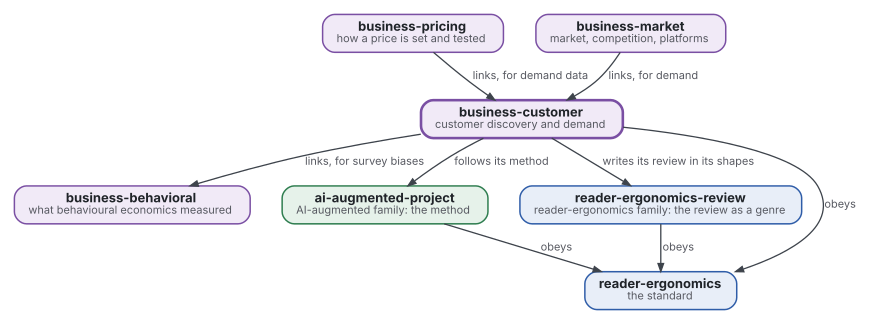
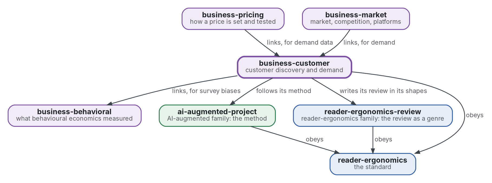

# Client et demande

[](https://github.com/Tewf/business-customer/actions/workflows/checks.yml)
[](https://tewf.github.io/business-customer/)

La découverte du client et l'**estimation de la demande** : entretiens et enquêtes avec leurs biais, expériences, modèles de choix discrets et segmentation, et une forme de protocole pour une étude client.

Cette page en anglais : [README.md](README.md). Les deux versions suivent le même état.

> **État (2026-11-04) :** la première revue est écrite, en première passe de 40 sources, et se termine sur une référence
> nommée, B1. Une forme de protocole pour une étude client a un programme qui la vérifie. Le nom est gardé après l'étape
> de cadrage ([fiche 0002](decisions/0002-keep-the-name-and-read-a-study-protocol-by-program.md)). Ce n'est ni une norme
> officielle, ni une étude relue par des pairs, ni un résultat nouveau.
>
> **Comment il est fait :** avec Claude, un assistant IA d'Anthropic, sous la direction du mainteneur, comme
> reader-ergonomics. Les corrections sont bienvenues sous forme d'issues.

## Où il se place



<details>
<summary>Graphviz source</summary>



</details>

- **Il lie [business-behavioral](https://github.com/Tewf/business-behavioral)** pour les biais que porte une réponse d'enquête.
- **[business-pricing](https://github.com/Tewf/business-pricing) et [business-market](https://github.com/Tewf/business-market) le lient** pour la preuve de la demande ; ce dépôt ne dépend d'aucun des deux.
- **Sa méthode est celle d'[ai-augmented-project](https://github.com/Tewf/ai-augmented-project)** : cadrer, revoir, fixer une référence et planifier, et les registres des décisions et des valeurs provisoires. Il ne dépend pas des autres parties de ce dépôt.
- **Il écrit sa revue dans les formes de [reader-ergonomics-review](https://github.com/Tewf/reader-ergonomics-review)**, la revue comme genre ; les formes sont celles de ce dépôt.
- **Il obéit à [reader-ergonomics](https://github.com/Tewf/reader-ergonomics/blob/65e42472e2d4cbfd994c2a86e95a47e5dc7301ca/standard.md)** (v1.24.2) et exécute ses vérifications en CI.
- **Il ne pointe que vers le bas.** La carte de la famille est [business](https://github.com/Tewf/business). Une entreprise n'apparaît ici que comme exemple, jamais comme sujet.

## Périmètre

| | Quoi | Pourquoi |
|---|---|---|
| dedans | les entretiens et les enquêtes, et le biais de chacun : questions orientées, désirabilité sociale, réponses hypothétiques | ce que dit un client est une donnée sur le client et sur la question, et une étude doit séparer les deux |
| dedans | les expériences sur la demande : un test qui change une chose et compte ce que font les clients | le comportement prouve mieux que l'opinion, et une expérience dit ce qui l'a causé |
| dedans | les modèles de choix discrets, depuis McFadden : la demande estimée à partir des choix des gens | les choix révèlent des arbitrages qu'une échelle de notes cache |
| dedans | la segmentation : des groupes de clients dont la demande diffère | une moyenne sur des groupes qui diffèrent n'en décrit aucun |
| dedans | une forme de protocole pour une étude client : question, échantillon, instrument et analyse fixés avant le premier entretien | un protocole écrit d'abord ne peut être plié par les réponses |
| plus tard | des panels qui suivent les mêmes clients dans le temps | ils demandent des clients, et un squelette n'en a pas |
| dehors | un prix et la disposition à payer qui le sous-tend | [business-pricing](https://github.com/Tewf/business-pricing) |
| dehors | la taille d'un marché | [business-market](https://github.com/Tewf/business-market) |
| dehors | quels biais se répliquent sur le terrain | [business-behavioral](https://github.com/Tewf/business-behavioral) |

## Ce que la revue a trouvé

- **Le domaine s'appelle analyse des choix discrets pour la demande, et méthodologie d'enquête pour le fait de demander.** La pratique appelle les entretiens « customer discovery ». Le nom du dépôt correspond en partie et est gardé.
- **Un changement d'intention donne un changement d'acte plus petit.** Sur 47 tests expérimentaux, d = 0,66 d'intention a donné d = 0,36 de comportement (Webb 2006, secondaire). Un incitatif sur le choix a amélioré la prédiction de l'achat (Ding 2005, secondaire).
- **Les entretiens d'un groupe homogène saturent vers 9 à 17.** C'est l'étendue de 23 tests (Hennink 2022, secondaire).
  - Un estimateur de l'invisible existe pour les problèmes d'usage, avec 31 % trouvés par utilisateur (Nielsen 2000).
  - Les groupes mêlés en demandent plus.
- **Les résultats de choix sont fragiles au plan.** Sur 107 études environnementales, de petits changements de plan ont déplacé les résultats dans 45 % des cas avec une mesure de fiabilité.
  - Le biais hypothétique était courant (Rakotonarivo 2016, secondaire).
- **Aucune forme de protocole pour une étude client, ni essai d'une telle forme contre des entretiens non structurés, n'a été trouvé.** Le plus proche est un plan fixé avant les résultats (Nosek 2018, secondaire). Le seul test randomisé d'une méthode enseignée porte sur 116 jeunes entreprises (Camuffo 2020, secondaire).

## Les questions, répondues

| Question | Réponse | Niveau |
|---|---|---|
| Entretiens | environ 9 à 17 pour un segment homogène ; un modèle de Poisson et une règle à seuil estiment l'invisible | mesuré, descriptif |
| Déclaré et révélé | d = 0,66 d'intention donne d = 0,36 de comportement ; l'écart se mesure par un acte observé après la réponse | mesuré |
| Modèles de choix | un plan conforme aux rapports des groupes de travail et un calcul de puissance ; aucune règle pour un bien nouveau trouvée | convention |
| Le protocole | la question, l'échantillon, l'instrument, l'ordre, l'incitatif et le plan d'analyse avant la première réponse ; un programme en vérifie trois | convention |

Les sources et les questions ouvertes sont dans [position](evidence/customer-demand/position.md).

## La référence

**B1** est une étude au protocole fixé avec un bras de choix discret, contre une série d'entretiens non structurés ([référence](evidence/customer-demand/baseline.md)).

- L'étude est écrite dans la [forme étude client](shapes/customer-study.md) : son échantillon, l'ordre de ses questions et son incitatif sont déclarés avant le premier entretien.
- Le bras de choix est d'abord exécuté sur des données simulées aux coefficients connus.

## La forme et sa vérification

- [shapes/customer-study.md](shapes/customer-study.md) est la forme d'une étude client, avec un [exemple rempli](shapes/examples/pre-order-interviews/study.md) sans aucun répondant réel.
- La vérification `customer-study` rejette une étude qui ne déclare ni taille d'échantillon, ni ordre numéroté des questions, ni incitatif et qui le paie ; ses tests sont dans [checks/test_customer_study.py](checks/test_customer_study.py).

## Vérifier

```sh
git clone https://github.com/Tewf/reader-ergonomics
python3 reader-ergonomics/checks/run.py chemin/vers/ce/depot
```

La CI exécute les mêmes vérifications à chaque push, et une exécution échoue à la première erreur
([checks.yml](https://github.com/Tewf/business-customer/blob/master/.github/workflows/checks.yml)). Chaque push sur
master construit aussi le site, [tewf.github.io/business-customer](https://tewf.github.io/business-customer/)
([pages.yml](https://github.com/Tewf/business-customer/blob/master/.github/workflows/pages.yml)).

## Contenu

| Partie | Résumé |
|---|---|
| [evidence](evidence/) | la première revue, une première passe de 40 sources, qui finit sur la référence B1, et la bibliographie |
| [shapes](shapes/) | la forme d'une étude client, avec un exemple rempli |
| [checks/local](checks/local/) | la vérification qu'une étude déclare son échantillon, l'ordre de ses questions et son incitatif |
| [decisions](decisions/) | une fiche par choix qui façonne ce dépôt, chacune ouvrant sur la décision en une phrase |

## Licence

Code sous [Apache License 2.0](LICENSE) ; prose sous [CC BY 4.0](LICENSES/CC-BY-4.0.txt). Réutilisez-le comme vous le
souhaitez, en créditant ce dépôt ; [CITATION.cff](CITATION.cff) donne une citation si besoin.
