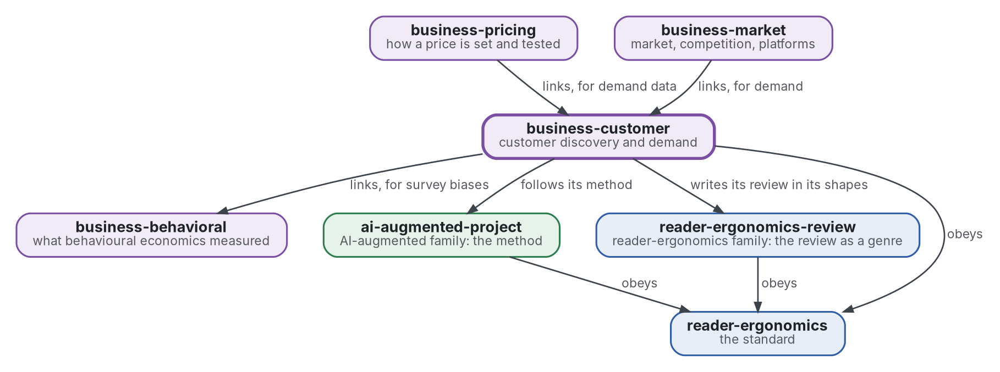

# Customer and demand

[](https://github.com/Tewf/business-customer/actions/workflows/checks.yml)
[](https://tewf.github.io/business-customer/)

Customer discovery and **demand estimation**: interviews and surveys with their biases, experiments, discrete choice models and segmentation, and a protocol shape for a customer study.

This page in French: [README.fr.md](README.fr.md).

> **Status (2026-11-04):** the first review is written, as a first pass of 40 sources, and ends on a named baseline,
> B1. A protocol shape for a customer study has a program that checks it. The name is kept after the frame step
> ([record 0002](decisions/0002-keep-the-name-and-read-a-study-protocol-by-program.md)). It is not an official
> standard, not a peer-reviewed study and not a new result.
>
> **How it is made:** with Claude, an AI assistant by Anthropic, under the maintainer's direction, the way
> reader-ergonomics was made. Corrections are welcome as issues.

## Where it sits


<details>
<summary>Graphviz source</summary>



</details>

- **It links [business-behavioral](https://github.com/Tewf/business-behavioral)** for the biases that a survey answer carries.
- **[business-pricing](https://github.com/Tewf/business-pricing) and [business-market](https://github.com/Tewf/business-market) link it** for demand evidence; this repository depends on neither.
- **Its method is [ai-augmented-project](https://github.com/Tewf/ai-augmented-project)'s**: scope, review, baseline and plan, and the registers of decisions and of provisional values. It does not depend on that repository's other parts.
- **It writes its review in the shapes of [reader-ergonomics-review](https://github.com/Tewf/reader-ergonomics-review)**, the review as a genre; the shapes are that repository's.
- **It obeys [reader-ergonomics](https://github.com/Tewf/reader-ergonomics/blob/65e42472e2d4cbfd994c2a86e95a47e5dc7301ca/standard.md)** (v1.24.2) and runs its checks in CI.
- **It links down only.** The family's map is [business](https://github.com/Tewf/business). A venture appears here as an example, never as the subject.

## Scope

| | What | Why |
|---|---|---|
| in | interviews and surveys, and the bias of each: leading questions, social desirability, hypothetical answers | what a customer says is data about the customer and about the question, and a study must separate the two |
| in | experiments on demand: a test that moves one thing and counts what customers do | behaviour is better evidence than opinion, and an experiment says what caused it |
| in | discrete choice models, from McFadden on: demand estimated from the choices people make | choices reveal trade-offs that a rating scale hides |
| in | segmentation: groups of customers whose demand differs | a mean over groups that differ describes none of them |
| in | a protocol shape for a customer study: question, sample, instrument and analysis fixed before the first interview | a protocol written first cannot be bent by the answers |
| later | panels that follow the same customers over time | they need customers, and a skeleton has none |
| out | a price and the willingness to pay behind it | [business-pricing](https://github.com/Tewf/business-pricing) |
| out | the size of a market | [business-market](https://github.com/Tewf/business-market) |
| out | which biases replicate in the field | [business-behavioral](https://github.com/Tewf/business-behavioral) |

## What the review found

- **The field's name is discrete choice analysis for demand, and survey methodology for the asking.** Practice calls the interviews customer discovery. The repository's name matches in part and is kept.
- **A change in intention gives a smaller change in action.** Over 47 experimental tests, d = 0.66 in intention gave d = 0.36 in behaviour (Webb 2006, secondary). An incentive on the choice improved the prediction of purchase (Ding 2005, secondary).
- **Interviews with a homogeneous group saturate at about 9 to 17.** That is the range of 23 tests (Hennink 2022, secondary).
  - An estimator of the unseen exists for usability problems, with 31% found per user (Nielsen 2000).
  - Mixed groups need more.
- **Choice results are fragile to design.** In 107 environmental studies, small design changes moved the results in 45% of outcomes with a reliability measure, and hypothetical bias was common (Rakotonarivo 2016, secondary).
- **No protocol shape for a customer study, and no trial of one against unstructured interviews, was found.** The nearest evidence is a plan fixed before the outcomes (Nosek 2018, secondary). The only randomized test of a taught method is on 116 startups (Camuffo 2020, secondary).

## The questions, answered

| Question | Answer | Grade |
|---|---|---|
| Interviews | about 9 to 17 for a homogeneous segment; a Poisson model and a threshold rule estimate the unseen | measured, descriptive |
| Stated and revealed | d = 0.66 in intention gives d = 0.36 in behaviour; the gap is measured by an action observed after the answer | measured |
| Choice models | a design to the task-force reports and a power calculation; no rule for a new good was found | convention |
| The protocol | the question, sample, instrument, order, incentive and analysis plan before the first answer; a program checks three of them | convention |

The sources and the open questions are in [position](evidence/customer-demand/position.md).

## The baseline

**B1** is a protocol-fixed study with a discrete choice arm, against an unstructured round of interviews ([baseline](evidence/customer-demand/baseline.md)).

- The study is written in the [customer-study shape](shapes/customer-study.md): its sample, its question order and its incentive are declared before the first interview.
- The choice arm is run first on simulated data with known coefficients.

## The shape and its check

- [shapes/customer-study.md](shapes/customer-study.md) is the shape of a customer study, with a [filled fixture](shapes/examples/pre-order-interviews/study.md) that holds no real respondent.
- The check `customer-study` fails a study that declares no sample size, no numbered question order or no incentive and who pays it; its tests are in [checks/test_customer_study.py](checks/test_customer_study.py).

## Check it

```sh
git clone https://github.com/Tewf/reader-ergonomics
python3 reader-ergonomics/checks/run.py path/to/this/repository
```

CI runs the same checks on every push, and a run fails on any error
([checks.yml](https://github.com/Tewf/business-customer/blob/master/.github/workflows/checks.yml)). Every push to
master also renders the site, [tewf.github.io/business-customer](https://tewf.github.io/business-customer/)
([pages.yml](https://github.com/Tewf/business-customer/blob/master/.github/workflows/pages.yml)).

## Contents

| Part | Summary |
|---|---|
| [evidence](evidence/) | the first review, a first pass of 40 sources, ending on the baseline B1, and the bibliography |
| [shapes](shapes/) | the shape of a customer study, with a filled fixture |
| [checks/local](checks/local/) | the check that a study declares its sample, its question order and its incentive |
| [decisions](decisions/) | one record per choice that shapes this repository, each opening with the decision in one sentence |

## Licence

Code under the [Apache License 2.0](LICENSE); prose under [CC BY 4.0](LICENSES/CC-BY-4.0.txt). Reuse it as you wish,
with credit to this repository; [CITATION.cff](CITATION.cff) gives a citation if you need one.
