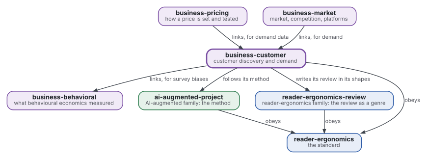
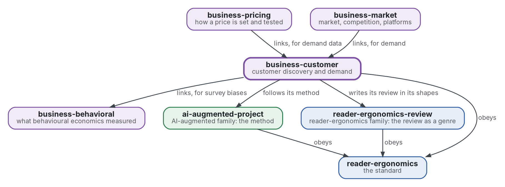

# Customer and demand

[](https://github.com/Tewf/business-customer/actions/workflows/checks.yml)
[](https://tewf.github.io/business-customer/)

Customer discovery and **demand estimation**: interviews and surveys with their biases, experiments, discrete choice models and segmentation, and a protocol shape for a customer study.

This page in French: [README.fr.md](README.fr.md).

> **Status (2026-11-04):** set up; nothing is written yet beyond the scope. The first job is a literature review, not
> started. The name is provisional until that review's first step says what the field calls this. It is not an
> official standard, not a peer-reviewed study and not a new result.
>
> **How it is made:** with Claude, an AI assistant by Anthropic, under the maintainer's direction, the way
> reader-ergonomics was made. Corrections are welcome as issues.

## Where it sits



<details>
<summary>Graphviz source</summary>



</details>

- **It links [business-behavioral](https://github.com/Tewf/business-behavioral)** for the biases that a survey answer carries.
- **[business-pricing](https://github.com/Tewf/business-pricing) and [business-market](https://github.com/Tewf/business-market) link it** for demand evidence; this repository depends on neither.
- **Its method is [ai-augmented-project](https://github.com/Tewf/ai-augmented-project)'s**: scope, review, baseline and plan, and the registers of decisions and of provisional values. It does not depend on that repository's other parts.
- **It writes its review in the shapes of [reader-ergonomics-review](https://github.com/Tewf/reader-ergonomics-review)**, the review as a genre; the shapes are that repository's.
- **It obeys [reader-ergonomics](https://github.com/Tewf/reader-ergonomics/blob/2e5b6f0c3e67d2dc8195a63cf882d46170e79a5a/standard.md)** (v1.21.0) and runs its checks in CI.
- **It links down only.** The family's map is [business](https://github.com/Tewf/business). A venture appears here as an example, never as the subject.

## Scope

| | What | Why |
|---|---|---|
| in | interviews and surveys, and the bias of each: leading questions, social desirability, hypothetical answers | what a customer says is data about the customer and about the question, and a study must separate the two |
| in | experiments on demand: a test that moves one thing and counts what customers do | behaviour is better evidence than opinion, and an experiment says what caused it |
| in | discrete choice models, from McFadden on: demand estimated from the choices people make | choices reveal trade-offs that a rating scale hides |
| in | segmentation: groups of customers whose demand differs | a mean over groups that differ describes none of them |
| in | a protocol shape for a customer study: question, sample, instrument and analysis fixed before the first interview | a protocol written first cannot be bent by the answers |
| later | panels that follow the same customers over time | they need customers, and a skeleton has none |
| out | a price and the willingness to pay behind it | [business-pricing](https://github.com/Tewf/business-pricing) |
| out | the size of a market | [business-market](https://github.com/Tewf/business-market) |
| out | which biases replicate in the field | [business-behavioral](https://github.com/Tewf/business-behavioral) |

## The first job: a literature review

Not started. It follows the order of a thesis review, and it is finished when it can name the baseline.

1. **Frame:** the problem in one sentence, and what each field calls it. Leads to verify: discrete choice analysis (McFadden), the customer-development literature as grey sources scored on Garousi 2019's criteria, survey methodology, and the measurement of hypothetical bias. The repository may be renamed then.
2. **Review:** each name, searched by its academic name, its acronym and its author; surveys first.
   - survey methodology and the biases of an interview, by their academic names and their authors, surveys first;
   - discrete choice models, from the seminal paper to a current textbook, with the software that estimates them;
   - customer-development practice as grey literature, each source scored, below the threshold an example only;
   - protocol shapes already in use for a study of people, found before one is written.
3. **State of the art, and the case against.**
4. **Position:** what this repository asks that the field does not already answer.
5. **Baseline:** a protocol for one customer study written in the shape the review finds, with a discrete choice estimate on simulated data, compared with an unstructured round of interviews as the practice.

## Questions the review must answer

- **Interviews.** How many interviews does a segment need before a new one adds little, and does an estimator of the unseen say so?
- **Stated and revealed.** How far does what customers say differ from what they do, and how is the gap measured?
- **Choice models.** What does a discrete choice study need in sample and design to estimate demand for a new good?
- **The protocol.** What must a protocol fix before the first question, and what can a program check in it?

## Check it

```sh
git clone https://github.com/Tewf/reader-ergonomics
python3 reader-ergonomics/checks/run.py path/to/this/repository
```

CI runs the same checks on every push, and a run fails on any error
([checks.yml](https://github.com/Tewf/business-customer/blob/master/.github/workflows/checks.yml)). Every push to
master also renders the site, [tewf.github.io/business-customer](https://tewf.github.io/business-customer/)
([pages.yml](https://github.com/Tewf/business-customer/blob/master/.github/workflows/pages.yml)).

## Contents

| Part | Summary |
|---|---|
| [decisions](decisions/) | one record per choice that shapes this repository, each opening with the decision in one sentence |

## Licence

Code under the [Apache License 2.0](LICENSE); prose under [CC BY 4.0](LICENSES/CC-BY-4.0.txt). Reuse it as you wish,
with credit to this repository; [CITATION.cff](CITATION.cff) gives a citation if you need one.
